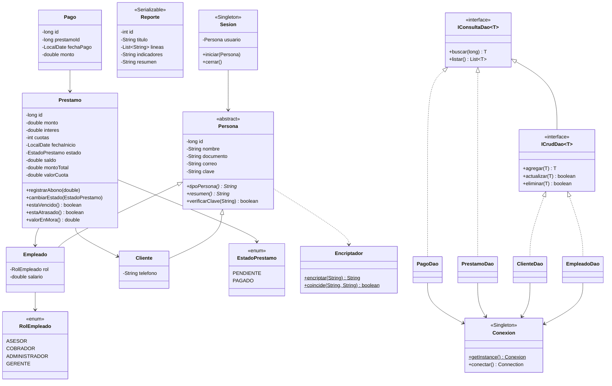
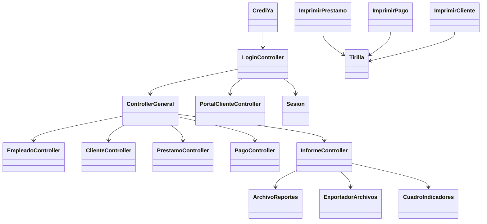
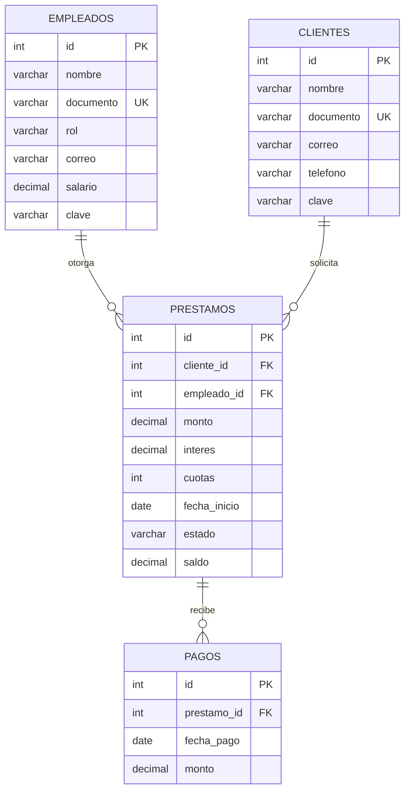

# CrediYa SAS — Sistema de préstamos y cobro de cartera

Aplicación de consola en **Java 21** para la empresa **CrediYa SAS**, dedicada a otorgar créditos personales. Reemplaza el control en hojas de cálculo por un sistema que gestiona **empleados, clientes, préstamos, pagos e informes**, con persistencia en **MySQL (JDBC)** y en **archivos**.

Proyecto del programa *Técnico en Programación de Software e IA* — Campuslands.

---

## Contenido

1. [Características](#características)
2. [Tecnologías](#tecnologías)
3. [Estructura del repositorio](#estructura-del-repositorio)
4. [Instalación y ejecución](#instalación-y-ejecución)
5. [Uso del sistema](#uso-del-sistema)
6. [Reglas de negocio](#reglas-de-negocio)
7. [Informes y archivos](#informes-y-archivos)
8. [Arquitectura](#arquitectura)
9. [Paquetes y clases](#paquetes-y-clases)
10. [Principios y patrones aplicados](#principios-y-patrones-aplicados)
11. [Diagramas](#diagramas)
12. [Base de datos](#base-de-datos)
13. [Solución de problemas](#solución-de-problemas)
14. [Autor](#autor)

---

## Características

- **Login con dos roles:** administrador (panel completo) y cliente (portal con solo su información).
- **Configuración inicial:** si no existe ningún administrador, el sistema pide crear el primero. Toda la información se registra desde Java.
- **CRUD completo** de empleados y clientes.
- **Préstamos:** cálculo automático del total con interés y de la cuota mensual, simulación antes de confirmar y cambio de estado (pendiente / pagado).
- **Pagos:** abonos que actualizan el saldo en una transacción y pasan el préstamo a PAGADO cuando el saldo llega a 0.
- **Impresión tipo tirilla:** estado de cuenta, recibo de pago (con paz y salvo) y listados en formato de factura.
- **7 informes con Lambda y Stream API**, cada uno con un cuadro de indicadores.
- **Persistencia en archivos:** reportes serializados en `.dat` y exportación a `.txt` y `.csv` (Excel).
- **Seguridad:** claves encriptadas con SHA-256, 3 intentos de ingreso y mensajes de error que no revelan datos.
- **Validaciones** en cada dato ingresado y **excepciones propias** que nunca cierran el programa.

---

## Tecnologías

| Herramienta | Versión | Uso |
|---|---|---|
| Java (JDK) | 21 | Lenguaje |
| Apache Maven | — | Dependencias y compilación |
| Apache NetBeans | 25 | IDE |
| MySQL Server | 8.0 | Base de datos |
| MySQL Workbench | 8.0 | Creación de la base y consultas |
| mysql-connector-j | 9.7.0 | Conexión JDBC |
| Git / GitHub | — | Control de versiones |

---

## Estructura del repositorio

```
Proyecto-Java-Crediya/
├── README.md
├── .gitignore
├── sql/
│   ├── CrediYa.sql              → crea la base crediya_db y sus 4 tablas (vacías)
│   └── insert-crediya.sql       → datos de prueba (opcional)
└── CrediYa/                     → proyecto Maven de NetBeans
    ├── pom.xml
    └── src/main/java/
        ├── com/john/crediya/    → main
        ├── controller/
        ├── model/
        ├── dao/
        ├── database/
        ├── archivo/
        ├── seguridad/
        ├── exception/
        └── view/                → login, portal, empleado, cliente, prestamo, pago, informe
```

Archivos que se generan al usar el programa (no se suben a GitHub, están en `.gitignore`):

| Archivo / carpeta | Se crea cuando |
|---|---|
| `CrediYa/target/` | Se compila el proyecto |
| `CrediYa/reportes_crediya.dat` | Se guarda un informe |
| `CrediYa/exportados/` | Se exporta un reporte a `.txt` o los préstamos a `.csv` |

---

## Instalación y ejecución

### Requisitos

- JDK 21 o superior
- Apache NetBeans 25 (o cualquier IDE con soporte Maven)
- MySQL Server 8 en ejecución y MySQL Workbench
- Conexión a internet la primera vez (Maven descarga el conector)

### 1. Clonar el repositorio

```bash
git clone https://github.com/Johncalderonb/Proyecto-Java-Crediya.git
```

### 2. Crear la base de datos

1. Abrir MySQL Workbench y conectarse al servidor local.
2. **File → Open SQL Script…** → `sql/CrediYa.sql` → ejecutar con el rayo ⚡.
3. Refrescar el panel **SCHEMAS**: debe aparecer `crediya_db` con las tablas `empleados`, `clientes`, `prestamos` y `pagos`.

Opcional: ejecutar `sql/insert-crediya.sql` para cargar datos de prueba. **Ese script borra los datos existentes** y deja 10 empleados, 10 clientes, 12 préstamos y 41 pagos.

### 3. Configurar la conexión

Editar `CrediYa/src/main/java/database/Conexion.java` con el usuario y la contraseña de **tu** MySQL:

```java
private final String url = "jdbc:mysql://localhost:3306/crediya_db";
private final String user = "root";
private final String password = "tu_contraseña";
```

### 4. Ejecutar

1. NetBeans → **File → Open Project** → seleccionar la carpeta `CrediYa`.
2. Clic derecho sobre el proyecto → **Clean and Build** → `BUILD SUCCESS`.
3. **F6** (Run). La aplicación se usa escribiendo en la ventana **Output**.

La clase que se ejecuta es `com.john.crediya.CrediYa`, definida en el `pom.xml` (`exec.mainClass`).

---

## Uso del sistema

### Inicio de sesión

```
1- Ingresar como administrador.
2- Ingresar como cliente.
3- Salir.
```

| Usuario | Ingresa con | Acceso |
|---|---|---|
| **Administrador** (empleado con rol ADMINISTRADOR) | Documento + clave | Panel completo |
| **Cliente** | Documento + clave asignada al registrarlo | Portal con solo sus datos |

- Con la base vacía, la opción 1 abre la **configuración inicial** para crear el primer administrador.
- Se permiten **3 intentos**. El mensaje de error es el mismo si falla el documento o la clave.

**Credenciales de los datos de prueba** (`insert-crediya.sql`):

| Rol | Documento | Clave |
|---|---|---|
| Administrador | `1098555666` | `admin123` |
| Administrador | `1098123456` | `natalia123` |
| Cliente (ejemplo) | `91234567` | `pedro123` |

Los clientes de prueba usan su nombre en minúscula + `123` como clave.

### Panel del administrador

| Módulo | Opciones |
|---|---|
| **1. Empleados** | Registrar, listar, buscar, actualizar (incluye restablecer clave), eliminar |
| **2. Clientes** | Registrar, listar, buscar, actualizar (incluye restablecer clave), eliminar, consultar préstamos del cliente |
| **3. Préstamos** | Crear (con simulación), listar, buscar (estado de cuenta), cambiar estado |
| **4. Pagos** | Registrar abono (con recibo), historial de un préstamo, listar todos los pagos |
| **5. Informes** | 7 informes, ver reportes guardados, exportar a `.txt` y a `.csv` |
| **6. Cerrar sesión** | Vuelve al login |

### Portal del cliente

| Opción | Qué hace |
|---|---|
| 1. Mis datos | Muestra su ficha |
| 2. Mis préstamos | Listado en tirilla con saldo total y mora |
| 3. Detalle e historial | Estado de cuenta de un préstamo con sus pagos |
| 4. Realizar un abono | Abona a uno de sus préstamos e imprime el recibo |
| 5. Cambiar mi clave | Pide la clave actual y la nueva dos veces |
| 6. Cerrar sesión | Vuelve al login |

Un cliente **nunca** puede ver ni pagar préstamos de otro cliente.

---

## Reglas de negocio

| Regla | Detalle |
|---|---|
| Total a pagar | `monto + monto × interés / 100` (interés simple sobre el total) |
| Cuota mensual | `total / número de cuotas` |
| Fecha final | `fecha de inicio + número de cuotas (meses)` |
| Abono | No puede ser 0 ni negativo, ni mayor al saldo, ni hacerse a un préstamo PAGADO |
| Préstamo pagado | Cuando el saldo llega a 0 el estado cambia solo a **PAGADO** |
| Cambio manual a PAGADO | Deja el saldo en 0 (previa confirmación) |
| Préstamo vencido | PENDIENTE y la fecha final ya pasó |
| Cliente moroso | Tiene un préstamo PENDIENTE donde lo pagado es menor que las cuotas que ya debería llevar |
| Valor en mora | `cuotas que debería llevar × cuota − total pagado` |
| Documentos | No se repiten entre empleados ni entre clientes (`UNIQUE`) |
| Eliminación | No se puede eliminar un empleado o cliente con préstamos asociados (`FOREIGN KEY`) |
| Préstamos y pagos | No se eliminan, para conservar el historial contable |
| Administrador conectado | No puede eliminarse ni quitarse el rol de ADMINISTRADOR |

---

## Informes y archivos

### Formato tirilla

| Dónde | Tirilla |
|---|---|
| Préstamos → Crear | SIMULACION DE PRESTAMO |
| Préstamos → Listar | LISTADO DE PRESTAMOS |
| Préstamos → Buscar / Cambiar estado | ESTADO DE CUENTA |
| Clientes → Listar | LISTADO DE CLIENTES |
| Pagos → Registrar abono | RECIBO DE PAGO (PAZ Y SALVO si el saldo queda en 0) |
| Pagos → Historial | ESTADO DE CUENTA |

```
==========================================
               CREDIYA SAS
           Creditos personales
         Bucaramanga - Santander
==========================================
          RECIBO DE PAGO No. 43
Impreso ................. 2026-11-06 21:23
------------------------------------------
Cliente ...................... Juan Torres
Saldo anterior .................. $720.000
VALOR ABONADO ................... $720.000
NUEVO SALDO ........................... $0
Estado ............................ PAGADO
==========================================
      PRESTAMO PAGADO - PAZ Y SALVO
==========================================
```

### Informes (Lambda y Stream API)

| # | Informe | Operaciones de Stream |
|---|---|---|
| 1 | Préstamos activos | `filter`, `sorted`, `map`, `sum` |
| 2 | Préstamos vencidos | `filter`, `sorted` |
| 3 | Clientes morosos | `filter`, `groupingBy`, recorrido con `entrySet` |
| 4 | Resumen de cartera por estado | `groupingBy` + `counting` + `summingDouble` |
| 5 | Gestión por empleado | `groupingBy`, `filter`, `count` |
| 6 | Top 5 clientes con mayor deuda | `groupingBy`, `sorted` descendente, `limit(5)` |
| 7 | Directorio general | `List<Persona>` + `map(Persona::resumen)` (polimorfismo) |

Cada informe empieza con un **cuadro de indicadores**:

```
+--------------------+--------------------+--------------------+
| Prestamos activos  | Cartera pendiente  |  Clientes en mora  |
|         9          |    $15.920.000     |         5          |
+--------------------+--------------------+--------------------+
| Prestamos vencidos |  Total recaudado   | Prestamos pagados  |
|         2          |     $5.725.000     |         3          |
+--------------------+--------------------+--------------------+
```

### Archivos

| Tipo | Archivo | Cómo |
|---|---|---|
| Serializado | `reportes_crediya.dat` | Al generar un informe → guardar. Se lee con **Informes → 8** |
| Texto | `exportados/reporte_N_titulo.txt` | **Informes → 9**: exporta un reporte guardado |
| Excel | `exportados/prestamos_AAAA-MM-DD.csv` | **Informes → 10**: todos los préstamos en 15 columnas, separadas por `;` |

---

## Arquitectura

El proyecto sigue **MVC + DAO**:

| Capa | Paquetes | Responsabilidad |
|---|---|---|
| **Vista** | `view`, `view.*` | Pregunta datos (validados) y muestra resultados. No accede a la base de datos |
| **Controlador** | `controller` | Coordina: recibe la opción, pide datos a la vista, usa el modelo y el DAO, decide el mensaje |
| **Modelo** | `model`, `exception` | Datos y reglas de negocio. No imprime en pantalla |
| **Acceso a datos** | `dao`, `database`, `archivo` | SQL con JDBC, conexión y archivos |
| **Seguridad** | `seguridad` | Encriptación de claves y sesión |

### Flujo de ejecución

```
F6 → CrediYa.main()
      └─ LoginController.iniciar()
          ├─ 1 Administrador → validar documento + clave + rol
          │     └─ ControllerGeneral (panel)
          │          ├─ EmpleadoController  → EmpleadoDao
          │          ├─ ClienteController   → ClienteDao, PrestamoDao
          │          ├─ PrestamoController  → PrestamoDao, PagoDao (+ Prestamo calcula)
          │          ├─ PagoController      → PagoDao (transacción)
          │          └─ InformeController   → Streams + ArchivoReportes + ExportadorArchivos
          ├─ 2 Cliente → validar documento + clave
          │     └─ PortalClienteController (solo sus préstamos)
          └─ 3 Salir → fin del programa
```

Cualquier error lanza una `CrediYaException`. El `try/catch` del menú la muestra y el programa sigue funcionando.

---

## Paquetes y clases

| Paquete | Clases | Descripción |
|---|---|---|
| `com.john.crediya` | `CrediYa` | Punto de entrada (`main`) |
| `controller` | `LoginController`, `ControllerGeneral`, `PortalClienteController`, `EmpleadoController`, `ClienteController`, `PrestamoController`, `PagoController`, `InformeController` | Un controlador por módulo |
| `model` | `Persona` (abstracta), `Empleado`, `Cliente`, `Prestamo`, `Pago`, `Reporte`, `RolEmpleado`, `EstadoPrestamo` | Entidades, enums y reglas de negocio |
| `dao` | `IConsultaDao`, `ICrudDao`, `EmpleadoDao`, `ClienteDao`, `PrestamoDao`, `PagoDao` | Interfaces y SQL por tabla |
| `database` | `Conexion` | Conexión JDBC (Singleton) |
| `archivo` | `ArchivoReportes`, `ExportadorArchivos` | `.dat` serializado y exportación a `.txt` / `.csv` |
| `seguridad` | `Encriptador`, `Sesion` | SHA-256 y usuario conectado (Singleton) |
| `exception` | `CrediYaException` | Excepción personalizada |
| `view` | `Validaciones`, `Mensajes`, `MenuGeneral`, `Tirilla` | Entrada validada, mensajes, menú del admin, formato tirilla |
| `view.login` | `MenuLogin`, `IngresoLogin` | Inicio de sesión |
| `view.portal` | `MenuPortalCliente` | Menú del cliente |
| `view.empleado` | `MenuEmpleado`, `IngresoEmpleado`, `ImprimirEmpleado` | Pantallas de empleados |
| `view.cliente` | `MenuCliente`, `IngresoCliente`, `ImprimirCliente` | Pantallas de clientes |
| `view.prestamo` | `MenuPrestamo`, `IngresoPrestamo`, `ImprimirPrestamo` | Pantallas de préstamos |
| `view.pago` | `MenuPago`, `IngresoPago`, `ImprimirPago` | Pantallas de pagos |
| `view.informe` | `MenuInforme`, `ImprimirInforme`, `CuadroIndicadores` | Pantallas de informes |

---

## Principios y patrones aplicados

### Programación orientada a objetos

| Concepto | Dónde |
|---|---|
| **Encapsulamiento** | Atributos `private` con getters y setters. `Prestamo` no tiene `setSaldo()`: el saldo solo cambia con `registrarAbono()` o `cambiarEstado()`, que validan |
| **Herencia** | `Empleado` y `Cliente` extienden `Persona` y usan `super(...)` |
| **Abstracción** | `Persona` es abstracta y declara `tipoPersona()` y `resumen()` |
| **Polimorfismo** | `resumen()` se comporta distinto en `Empleado` y `Cliente` (informe Directorio general) |
| **Asociación** | `Prestamo` guarda los objetos `Cliente` y `Empleado` |

### SOLID

| Principio | Aplicación |
|---|---|
| **S** — Responsabilidad única | Cada clase hace una cosa: menús, ingreso, impresión, SQL, reglas y coordinación están separados |
| **O** — Abierto/cerrado | Un informe nuevo se agrega como un método nuevo que reutiliza `presentar()`, sin modificar los existentes |
| **I** — Segregación de interfaces | `IConsultaDao` (consultar) e `ICrudDao` (CRUD completo): pagos y préstamos no están obligados a implementar `eliminar` |
| **D** — Inversión de dependencias | Los DAO cumplen contratos definidos por interfaces |

### Patrones de diseño

| Patrón | Dónde |
|---|---|
| **MVC** | Paquetes `view`, `controller` y `model` |
| **DAO** | Paquete `dao` |
| **Singleton** | `Conexion.getInstance()` y `Sesion.getInstance()` |
| **Builder** | `Tirilla` y `CuadroIndicadores` (métodos encadenados con `return this`) |

### Lambda, Stream y colecciones

- `Predicate`, `Function` y `Consumer` guardados como variables reutilizables.
- `filter`, `map`, `sorted`, `mapToDouble`, `sum`, `count`, `distinct`, `limit`, `anyMatch`, `groupingBy`, `counting`, `summingDouble`, `Predicate.negate()`.
- `List`, `ArrayList`, `Map` (recorrido con `entrySet`) y enums con `values()`.

### Excepciones y validaciones

- `CrediYaException` para errores de negocio y de base de datos.
- `Validaciones` repite cada pregunta hasta recibir un dato válido.
- Un único `try/catch` por menú: ningún error cierra la aplicación.
- `rollback()` en el registro de pagos si falla alguna operación.

---

## Diagramas

### Diagrama de clases (modelo, DAO y seguridad)



### Diagrama de controladores



### Modelo entidad-relación



---

## Base de datos

Base: **`crediya_db`** (script `sql/CrediYa.sql`).

| Tabla | Columnas principales | Restricciones |
|---|---|---|
| `empleados` | id, nombre, documento, rol, correo, salario, clave | `documento` UNIQUE |
| `clientes` | id, nombre, documento, correo, telefono, clave | `documento` UNIQUE |
| `prestamos` | id, cliente_id, empleado_id, monto, interes, cuotas, fecha_inicio, estado, saldo | FK a `clientes` y `empleados`; `estado` por defecto PENDIENTE |
| `pagos` | id, prestamo_id, fecha_pago, monto | FK a `prestamos` |

- `clave` guarda el código **SHA-256** (64 caracteres), nunca la clave real.
- `saldo` se agregó al modelo base para no sumar los pagos en cada consulta.

Consultas útiles en Workbench:

```sql
USE crediya_db;
SELECT id, nombre, documento, rol FROM empleados WHERE rol = 'ADMINISTRADOR';
SELECT * FROM prestamos WHERE estado = 'PENDIENTE';
UPDATE empleados SET clave = SHA2('nuevaClave', 256) WHERE documento = '1098555666';  -- restablecer clave
```

---

## Solución de problemas

| Mensaje | Causa | Solución |
|---|---|---|
| `Access denied for user 'root'@'localhost'` | Contraseña incorrecta en `Conexion.java` | Usar la misma contraseña de MySQL Workbench |
| `Unknown database 'crediya_db'` | La base no existe | Ejecutar `sql/CrediYa.sql` con ⚡ |
| `Unknown column 'clave'` | Base creada con un script antiguo | `DROP DATABASE crediya_db;` y ejecutar de nuevo `sql/CrediYa.sql` |
| `Communications link failure` | MySQL apagado | Iniciar el servicio MySQL80 |
| `ClassNotFoundException` al ejecutar | Se está ejecutando otro proyecto | Abrir `CrediYa` y verificar en Properties → Sources la ruta del proyecto |
| "Documento o clave incorrectos" con la clave correcta | El empleado no tiene rol ADMINISTRADOR | Revisarlo con la consulta de administradores |
| Excel muestra el CSV en una sola columna | Excel configurado con `,` como separador | Datos → Desde texto/CSV → delimitador **Punto y coma** |

---

## Autor

**John Faver Calderón Barragán** — [@Johncalderonb](https://github.com/Johncalderonb)
Técnico en Programación de Software e IA — Campuslands
